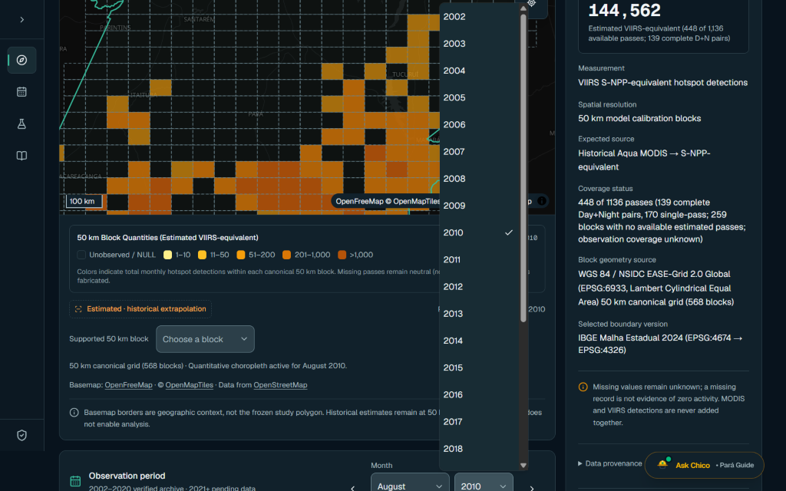
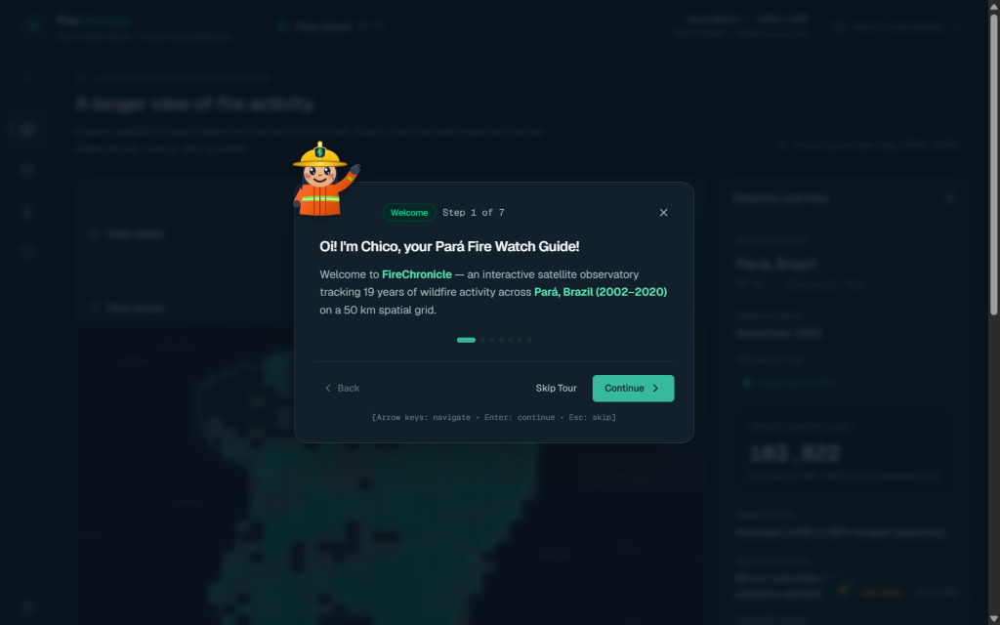
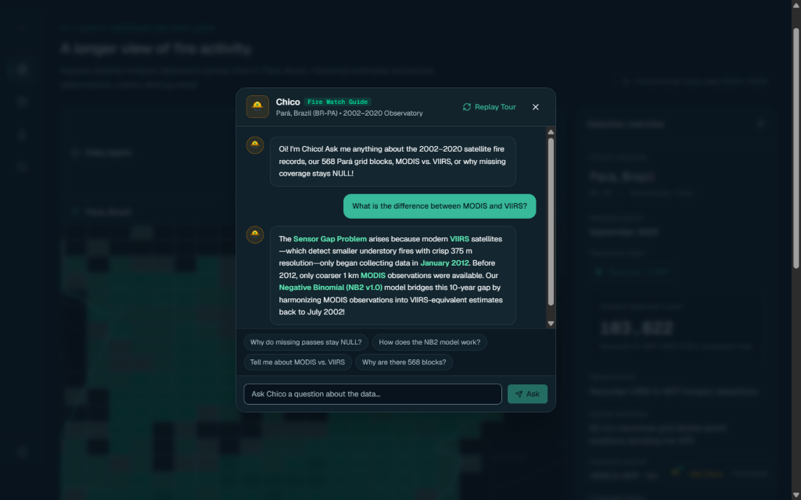
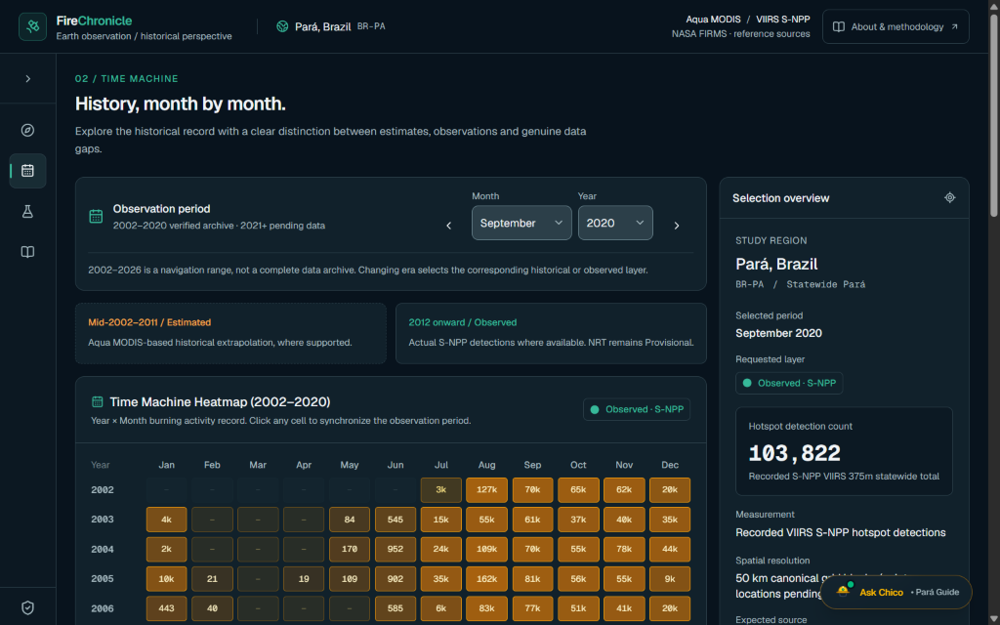
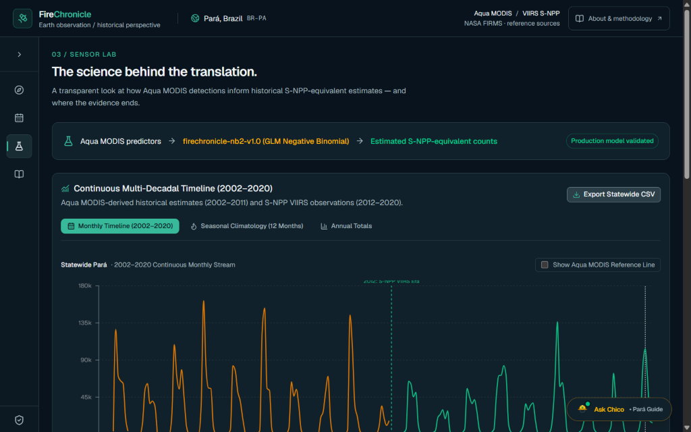
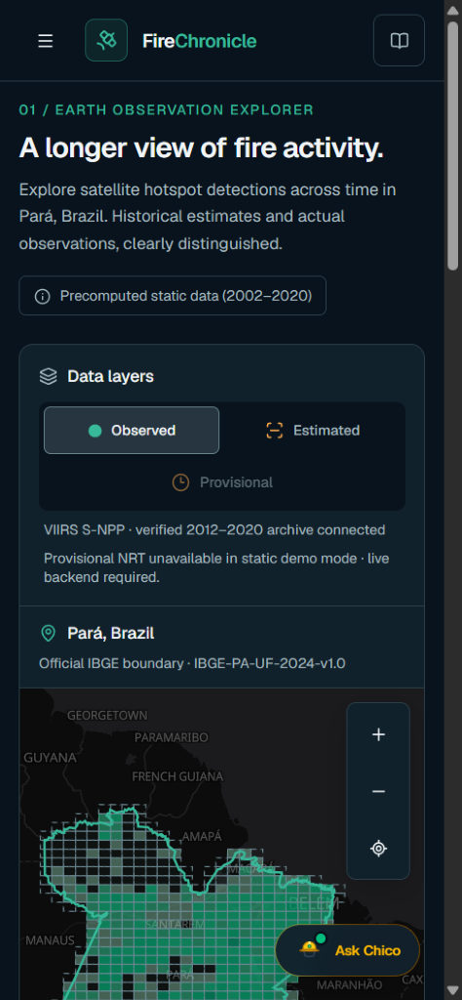

# FireChronicle

### Multi-Decadal Earth Observation & Harmonization of Satellite Active Fire Hotspots across Pará, Brazil (2002–2020)

[](https://www.spaceappschallenge.org/)
[](https://firechronicle.vercel.app/)
[](https://github.com/inan001/firechronicle)
[](https://firechronicle.vercel.app/sensor-lab)
[](https://github.com/inan001/firechronicle)
[-6366f1?style=for-the-badge)](https://firechronicle.vercel.app/)

> **NASA Space Apps Challenge 2026** — *[Harmonization of MODIS and VIIRS Hot Spots](https://www.spaceappschallenge.org/2026/challenges/modis-and-viirs-hot-spots/)*  
> **Team:** Team Meghna  
> **Production Platform:** [https://firechronicle.vercel.app/](https://firechronicle.vercel.app/)  
> **Official Repository:** [Team Meghna — FireChronicle](https://github.com/inan001/firechronicle)  
> **Release Branch:** [`main`](https://github.com/inan001/firechronicle/tree/main)  
> 🎬 **Official 30-Second Competition Video:** [Watch FireChronicle — Team Meghna on YouTube](https://www.youtube.com/watch?v=_gfLNVskcRE)  

---

[](https://www.youtube.com/watch?v=_gfLNVskcRE)  
*Watch Team Meghna's official 30-second competition demonstration video on YouTube.*

## 1. Executive Overview & The Decadal Sensor Challenge

FireChronicle is a public satellite Earth observation analytics platform tracking 19 years of active fire hotspot detections across all **568 canonical 50 km grid blocks** in **Pará, Brazil (`BR-PA`)**. The platform structures a complete 19-year, 228-calendar-month timeline (January 2002 – December 2020), spanning the 222 operational satellite months from July 2002 through December 2020 alongside 6 unsupported pre-commissioning months (January–June 2002).


*Figure 1: Explore Pará interactive workspace displaying the August 2005 severe drought period (~161,941 estimated detections) across the official IBGE 2024 boundary and 568 canonical 50 km blocks.*

### The Environmental Problem: The Satellite Sensor Discontinuity
Long-term environmental monitoring of the Amazon rainforest relies heavily on NASA's spaceborne thermal infrared active-fire instruments:
- **Aqua MODIS (2002–present):** 1 km spatial resolution at nadir.
- **Suomi-NPP VIIRS (2012–present):** 375 m I-band resolution (~10× smaller ground footprint at nadir).

Because VIIRS operates with a significantly smaller pixel footprint and higher thermal sensitivity, it detects smaller and lower-intensity fires that MODIS frequently does not register. However, spaceborne thermal detection of sub-canopy burning remains constrained by forest canopy obscuration, smoke attenuation, and cloud cover.

Crucially, differences in sensor resolution and detection thresholds create a major **sensor discontinuity** between the two observational records. Comparing or aggregating raw Aqua MODIS counts (2002–2011) with raw VIIRS counts (2012–2020) without cross-sensor calibration distorts interpretations of multi-decadal fire-detection trends. Directly summing raw counts across the 2012 sensor transition is methodologically invalid.

### Why Pará, Brazil?

Pará is a scientifically meaningful case-study region within the Brazilian Amazon, where historical burning, deforestation-related land-use pressures, and conservation challenges create an important setting for examining long-term satellite-detected fire activity. Regional fire-management research documents the relationship between fire patterns, land use, and environmental pressures in Pará.

FireChronicle focuses on a clearly defined geographic area rather than assuming that a single statistical calibration can represent every biome or country. The official IBGE state boundary and **568 canonical approximately 50 km equal-area grid blocks (EPSG:6933)** provide a consistent spatial framework for analyzing historical MODIS and VIIRS detections.

This regional focus supports geographically interpretable results, transparent validation, and a reproducible case study of satellite sensor harmonization. **The frozen NB2 v1.0 model is calibrated specifically for Pará; applying it elsewhere would require additional regional calibration and evaluation.** For regional fire-management context, see [IPAM — Gestão do Fogo na Amazônia: Pará](https://ipam.org.br/wp-content/uploads/2025/10/PA-PARA-Gestao-do-Fogo-Amazonia_WSM_V8-ALTA-1.pdf).

### Current Scope & Future Expansion

**Current capability:** FireChronicle is a working, regionally calibrated historical Earth-observation platform focused on **Pará, Brazil**. Its 568 canonical approximately 50 km equal-area grid blocks and frozen NB2 v1.0 model support harmonized analysis of satellite active-fire detections within the project's defined **2002–2020 historical dataset**.

**Future direction:** Team Meghna intends to extend this approach to **other Brazilian Amazon states**, with the longer-term goal of investigating coverage across the **wider Amazon basin and potentially other fire-affected regions**. We also aim to explore extending the historical record beyond December 2020, improving scientific accessibility, and strengthening regional and temporal validation.

**Scientific requirements for expansion:** Broader coverage is not a simple geographic extension of the existing model. Each additional region or observation period would require authentic satellite data processing, spatial-grid preparation, assessment of Day/Night observation completeness, and appropriate recalibration or independent validation of the MODIS–VIIRS harmonization model. Post-2020 expansion would additionally require assessing changes in Aqua MODIS sampling conditions associated with documented orbital drift beginning in 2021.

**Development status:** These are proposed future research and engineering directions, **not features currently deployed or validated**. FireChronicle does not currently provide global coverage, live wildfire alerts, or future-fire prediction.

### The Scientific Solution: Empirically Calibrated Harmonization
FireChronicle bridges this 10-year observational gap:
1. **Nine Years of Direct Overlap:** Calibrated on 23,010 paired-positive cell-months ($M > 0$ and $V > 0$) across the 2012–2020 concurrent observation window.
2. **Negative Binomial GLM (NB2 v1.0):** An empirically fitted Generalized Linear Model accounting for strong overdispersion ($\alpha = 0.3394$), seasonal fixed effects, and diurnal day/night overpass dynamics.
3. **Strict Era Separation:** Reconstructs VIIRS-equivalent historical activity back to July 2002 while strictly distinguishing the **Estimated Era (2002–2011)** from the **Observed Era (2012–2020)**.

### Why FireChronicle Matters

Understanding how fire activity changes across decades is important for studying the Amazon's environment. But when satellite sensors detect hotspots differently, changes in the recorded counts may reflect differences in the instruments rather than changes in fire activity alone.

FireChronicle helps environmental researchers, conservation organizations, and Earth-observation analysts explore historical fire-detection patterns more consistently. By connecting statistically estimated historical detections with observed VIIRS records—and making the results accessible through interactive maps and timelines—it supports more informed interpretation of long-term environmental data.

**Our goal is simple: make decades of satellite fire observations easier to compare, explore, and understand.**

### Real-World Applications

FireChronicle is designed to provide actionable historical context for researchers, land managers, and environmental analysts studying fire regimes in the Brazilian Amazon:

- **Environmental Researchers:** Examine multi-decadal satellite-detected fire trends (2002–2020) while accounting for structural sensor resolution differences (1 km vs. 375 m) and detection sensitivity shifts between Aqua MODIS and Suomi-NPP VIIRS, avoiding naive count aggregation.
- **Land Managers and Conservation Analysts:** Identify historical periods or geographic blocks with elevated satellite hotspot detections across Pará's 568 canonical 50 km blocks to prioritize specific zones for retrospective landscape investigation and protected-area vulnerability assessments.
- **Fire-Risk and Preparedness Analysts:** Use multi-decadal historical hotspot distributions as empirical baseline context when analyzing regional fire seasonality, peak burning months (August–November), and historical drought-year dynamics.

> [!IMPORTANT]
> **Operational Scope & Methodological Boundaries:**
> - **No Future Wildfire Forecasting:** FireChronicle reconstructs historical satellite observations; it does not forecast future fire occurrences, fire spread, or real-time ignition probability.
> - **No Operational Emergency Alerts:** The platform is an analytical retrospective research instrument, not an operational early-warning or active-fire dispatch system.
> - **Historical Context $\neq$ Future Risk:** Historical detection frequency provides empirical context but does not directly establish future fire risk under evolving climate and land-use conditions.
> - **Hotspot Detections $\neq$ Wildfire Incidents:** Satellite active-fire hotspots denote thermal radiation anomalies within 375 m or 1 km pixels at satellite overpass time. A single large wildfire can trigger multiple contiguous hotspot detections across successive overpasses, whereas smaller fires beneath dense canopy may produce none.
> - **Plausible Decision Support:** The applications above represent prospective research and decision-support use cases; FireChronicle does not claim proven field policy interventions or documented regulatory outcomes.

#### Illustrative Case Study: The August 2005 Amazon Drought in Pará
During the severe 2005 Amazon drought, eastern and southern Pará experienced intense burning. In FireChronicle's precomputed historical dataset ([`public/data/timeseries/statewide_monthly.json`](public/data/timeseries/statewide_monthly.json)), **August 2005** (`period = "2005-08"`, `region_id = "BR-PA"`) records a statewide total of **161,940.5 estimated VIIRS-equivalent hotspot detections** (commonly rounded to ~161,941).

> [!IMPORTANT]
> **Measurement Units & Detection Meaning:**  
> The measurement unit is `VIIRS_S-NPP-equivalent_detection_count`. This value is a statistical model estimate (Aqua MODIS $\rightarrow$ frozen NB2 v1.0 GLM) representing satellite thermal radiation anomaly pixel detections at overpass times. It must **not** be interpreted as 161,940 individual ground wildfire incidents.

**Coverage Scope & Data Reconciliation:**
- **Expected Passes:** 1,136 total passes across all 568 canonical blocks (568 Day + 568 Night).
- **Available Estimated Passes:** 517 passes across the state.
- **Complete Day+Night Pairs:** Exactly **177 blocks** possessed complete Day and Night passes; their calibrated sum constitutes the official `161,940.5` strict statewide total (conditional on valid complete-pair coverage, rather than a full census of all blocks across the state).
- **Incomplete / Single-Pass Blocks:** **163 blocks** had only a single pass (Day or Night). Under FireChronicle's strict `daynight=ALL` contract, these 163 blocks are preserved as `NULL` in the statewide sum to maintain consistent diurnal sampling criteria and reduce potential bias caused by incomplete overpass coverage (their available single-pass sum of `169,376.6` is preserved separately in metadata).
- **Unobserved Blocks:** **228 blocks** had zero available estimated passes in this period.

Using FireChronicle, a researcher can navigate the Time Machine to inspect August 2005 as an extreme drought period (illustrated in Figure 1 above), observe localized hotspot concentrations along the southern and eastern "Arc of Deforestation" blocks, and audit the complete-versus-incomplete pass coverage metadata directly in the Analysis Panel.

### What Makes FireChronicle Different?

What does FireChronicle contribute beyond raw NASA FIRMS data access or a conventional historical fire mapping dashboard?

FireChronicle delivers a scientifically grounded, end-to-end integration addressing the fundamental challenges of multi-decadal satellite fire observation:

1. **Empirically Calibrated Harmonization:** Rather than displaying disjointed or uncalibrated raw counts, FireChronicle applies a frozen Negative Binomial GLM (**NB2 v1.0**, $\alpha = 0.3394$, $k = 6.0538$) trained on 23,010 paired-positive cell-months to reconstruct continuous VIIRS-equivalent historical activity back to July 2002.
2. **Standardized Canonical Spatial Grid:** Organizes statewide data into **568 equal-area 50 km blocks** (NSIDC EASE-Grid 2.0 Global, EPSG:6933) clipped to the official IBGE 2024 boundary, avoiding arbitrary administrative boundaries or irregular spatial aggregations.
3. **Strict Era Separation:** Clearly partitions the 19-year timeline into the **Estimated Era (2002–2011)** and **Observed Era (2012–2020)** with distinct visual palettes (Warm Amber vs. Vibrant Emerald), preventing misinterpretation of model estimates as direct satellite observations.
4. **Explicit Scientific Treatment of Data Gaps:** Preserves orbital gaps, partial launch months, and incomplete diurnal passes as `NULL`, eliminating historical reporting defects where missing satellite passes falsely appeared as zero fire activity (demonstrated by the audited March 2004 coverage fix).
5. **Integrated Analytical & Educational Toolset:** Combines interactive MapLibre GL spatial choropleths, a 19-year calendar matrix with Recharts seasonal climatology, the transparent Sensor Lab validation bench, and Chico Mendes-inspired guided onboarding with rule-based scientific safeguards.
6. **Open Science & Transparent Validation:** Features a public test suite (42 automated tests), complete holdout validation benchmarks, inspectable model artifacts, and one-click RFC 4180 CSV data exports with strict NULL preservation across all 228 calendar months.

> [!NOTE]
> **Innovation Scope:** FireChronicle does not claim to have invented Negative Binomial regression, nor does it claim that NASA FIRMS does not already provide invaluable Earth observation data. We do not claim this is the world's first fire dashboard, nor that our statistical model generalizes globally without regional recalibration. The project's innovation lies in its rigorous, end-to-end methodology, transparent handling of satellite discontinuities, and accessible implementation specifically engineered for Pará, Brazil.

### How FireChronicle Addresses the Challenge

| NASA Challenge Requirement | FireChronicle Implementation |
| :--- | :--- |
| **Harmonize historical MODIS and VIIRS hotspot records** | Empirically fitted NB2 v1.0 GLM ($\alpha = 0.3394$) bridges the 10-year pre-VIIRS gap by estimating VIIRS-equivalent detections from Aqua MODIS observations. |
| **Examine historical burning-activity patterns** | Interactive 19-year Time Machine calendar matrix (228 calendar months, 2002–2020) and Recharts seasonal climatology. |
| **Explore selected geographic areas** | Explore Pará interactive choropleth rendering 568 canonical 50 km equal-area spatial blocks (EPSG:6933) within the official IBGE 2024 boundary. |
| **Interpret results responsibly** | Clear Estimated vs. Observed era labeling, strict NULL preservation for missing passes (e.g., March 2004 fix), and transparent Sensor Lab metrics. |
| **Make Earth observation data accessible** | Zero-backend Next.js edge platform, Chico interactive science tour guide, and RFC 4180 CSV export. |

*Geographic Scope Note:* FireChronicle is currently calibrated and verified specifically for **Pará, Brazil (`BR-PA`)**. It does not provide global coverage or an uncalibrated worldwide monitoring service.

---

## 2. Interactive Feature Gallery

FireChronicle presents six core modules designed for researchers, environmental monitors, and competition judges:

| Feature Module | Purpose & Capabilities | Visual Preview |
| :--- | :--- | :---: |
| **Explore Pará**<br>`/` | Interactive MapLibre GL choropleth rendering the official **IBGE 2024** state boundary and 568 canonical 50 km blocks (EPSG:6933). Dynamically shifts between **Warm Amber** (Estimated era) and **Vibrant Emerald** (Observed era). Hover cards and click inspection display localized block time series, hotspot detection counts, and pass coverage metadata (reconciling complete Day+Night passes and preserving NULLs for unobserved blocks). |  |
| **Chico — Interactive Science Guide**<br>*Onboarding Tour & Q&A* (`/api/chico`) | Chico is FireChronicle's interactive science guide, featuring a seven-step onboarding tour and rule-based scientific Q&A safeguards. The current production configuration uses deterministic rulebook-fallback responses; optional generative AI integration is available through a separately configured backend adapter.<br><br>• **7-Step Onboarding Tour:** Inspired by Amazonian conservationist Chico Mendes, Chico introduces users to sensor discontinuities, spatial grids, the 228-month calendar timeline (222 operational months from July 2002 through December 2020, with Jan–Jun 2002 unsupported), and diurnal overpasses. Fully keyboard accessible (`Arrows`, `Enter`, `Esc`) with instant tour replay.<br>• **Safeguarded Science Guidance:** Directly answers queries regarding sensor differences, era boundaries, and missing coverage from an audited local rulebook without requiring external network services. | <br><br> |
| **Time Machine**<br>`/time-machine` | 19-Year Calendar Matrix spanning all 228 calendar months (January 2002 – December 2020). Clearly separates the 6 unsupported pre-commissioning months (Jan–Jun 2002, preserved as `NULL`) from the 222 operational months (July 2002 – December 2020). Accurately distinguishes partial observation launch periods (July 2002, January 2012) and the audited **March 2004 Insufficient Coverage fix** (hatched visual pattern; preserved as `NULL`, not zero). Neither 228 nor 222 implies universal data availability: orbital gaps and missing passes are strictly maintained as unobserved `NULL` values. Includes Recharts seasonal climatology and annual totals. |  |
| **Sensor Lab**<br>`/sensor-lab` | Transparent public evaluation lab presenting authoritative holdout validation benchmarks (Strategy A Temporal & Strategy B Geographic), full GLM NB2 parameters, and a multi-decadal continuous timeline with an interactive raw Aqua MODIS reference toggle. |  |
| **Responsive Interface**<br>*Mobile & Desktop* | Touch-friendly responsive layout supporting phone and tablet viewports with collapsable analytical sheets, touch-optimized temporal scrubbing, and fluid MapLibre viewport controls. |  |
| **CSV Data Export**<br>*RFC 4180 Standard* | One-click instant data export for Statewide Pará or any individual 50 km block across the complete 228-month calendar grid (including the 6 pre-commissioning `NULL` rows and the 222 operational months from July 2002 to December 2020). Fully preserves `NULL` values for unobserved or incomplete passes and separates Day, Night, and strict `daynight=ALL` observation channels according to RFC 4180 standards. | *Available on all views* |

---

## 3. Authoritative Scientific Validation

The production **NB2 v1.0** model was rigorously validated against a standard Ratio-of-Totals baseline ($k = \sum V / \sum M$) using two strictly held-out evaluation splits.

### Benchmark Validation Results

| Evaluation Strategy | Data Split & Sample Size | NB2 v1.0 MAE | Ratio Baseline MAE | Improvement (Error Reduction) | Additional Validated Metrics |
| :--- | :--- | :---: | :---: | :---: | :--- |
| **Strategy A: Prospective Temporal Holdout** | **Train:** 2012–2018 ($N = 17,919$)<br>**Test:** 2019–2020 ($N = 5,091$) across 24 unseen months | **35.44** | 44.99 | **21.2% lower MAE**<br>*(Deviance: -54.8%)* | • Poisson Deviance: **25.01** (vs 55.31)<br>• Monthly WAPE: **16.79%** (vs 20.48%)<br>• Monthly $R^2$: **0.9148** (vs 0.9009)<br>• Aggregate Bias: **-11.50%** (vs -12.91%) |
| **Strategy B: Grouped Geographic Holdout** | **Train:** 376 spatial blocks ($N = 17,863$)<br>**Test:** 94 completely withheld blocks ($N = 5,147$) | **35.79** | 53.87 | **33.6% lower MAE**<br>*(Deviance: -62.8%)* | • Poisson Deviance: **20.95** (vs 56.35)<br>• Spatial WAPE: **34.15%** (vs 51.39%)<br>• Monthly Correlation: **0.994** |

> [!IMPORTANT]
> **Metric Clarification:** The percentage improvements above represent **reductions in Mean Absolute Error (MAE) and Poisson Deviance** relative to the ratio baseline. They do not represent percentage accuracy scores. Monthly $R^2 = 0.9148$ denotes the coefficient of determination for monthly aggregate variance ($1 - \frac{\text{SS}_{\text{res}}}{\text{SS}_{\text{tot}}}$).

### Frozen Production Model Specification (NB2 v1.0)
- **Model Family:** Generalized Linear Model (GLM).
- **Distribution:** Negative Binomial (`NB2`) with logarithmic link function:
  $$\log(\mu_i) = \beta_0 + \beta_1 \log(1 + M_i) + \sum_{m=2}^{12} \beta_m \mathbb{I}(\text{month}_i = m) + \beta_N \mathbb{I}(\text{daynight}_i = \text{'N'})$$
- **Dispersion Parameter ($\alpha$):** `0.3394` (demonstrating variance $\text{Var}(Y) = \mu + \alpha \mu^2$, rejecting equidispersion Poisson assumptions).
- **Baseline Calibration Multiplier ($k$):** `6.0538`.
- **Model Fit Criteria:** AIC = `210,357.6` · BIC = `210,478.2`.
- **Spatial Fixed Effects:** Intentionally excluded to guarantee spatially uniform calibration across all 568 blocks without localized overfitting.

### Paired-Positive Calibration & Domain Boundary Clarification

The NB2 v1.0 training population consists of **23,010 paired-positive cell-months** ($M_i > 0$ and $V_i > 0$) observed across concurrent Aqua MODIS and Suomi-NPP VIIRS passes during the 2012–2020 overlap window.

> [!WARNING]
> **Domain Boundary & Generalization Limits:**
> - **Held-Out Validation Domain:** The reported holdout improvements (21.2% MAE reduction temporally, 33.6% MAE reduction geographically) were measured on strictly held-out partitions of paired-positive observations.
> - **Zero-Count & Detection Thresholds:** These validation metrics do **not** automatically establish equivalent performance for zero-detection conditions (e.g., where VIIRS detects a small fire missed entirely by MODIS, or where both sensors record zero).
> - **Incomplete Satellite Coverage:** Validation metrics do not apply to unobserved passes or blocks with orbital gaps; these periods are strictly held as `NULL`.
> - **Severe Drought Extrapolation ($M > 504$):** During the 2012–2020 training period, the maximum observed monthly block MODIS count was $M = 504$. In historical extreme drought years (2004, 2005, 2007, and 2010), 35 block-months exceeded $M = 504$ (reaching up to $M = 1,001$). Model predictions above $M = 504$ represent parametric extrapolation beyond empirical training bounds.
> - **Geographic Specificity:** Calibration parameters reflect the burning regimes, land-cover characteristics, and atmospheric conditions of Pará, Brazil. They cannot be assumed to apply to other biomes or geographic regions without empirical recalibration.

### Inspecting and Reproducing Scientific Results

Key model specifications, validation benchmark summaries, evaluation scripts, and data contracts are preserved directly within the repository for inspection, testing, and independent verification:

| Artifact / Milestone | Repository Relative Path | Description |
| :--- | :--- | :--- |
| **Frozen Model Specification** | [`model/artifacts/model_info_final_nb2.json`](model/artifacts/model_info_final_nb2.json) | Complete parameters, coefficients ($\beta$), dispersion ($\alpha = 0.3394$), and baseline multiplier ($k = 6.0538$). |
| **Validation Benchmark Outputs** | [`model/artifacts/validation_metrics_final_nb2.json`](model/artifacts/validation_metrics_final_nb2.json) | Authoritative holdout metrics for Strategy A (Temporal) and Strategy B (Geographic), deviance, and sensitivity experiments. |
| **Scientific Model Cards** | [`model/MODEL_CARD_FINAL_NB2.md`](model/MODEL_CARD_FINAL_NB2.md)<br>[`model/MODEL_VALIDATION_SUMMARY.md`](model/MODEL_VALIDATION_SUMMARY.md) | In-depth technical documentation covering data filtering, log-linear link formulation, and error distributions. |
| **Model & Baseline Source Code** | [`model/negative_binomial.py`](model/negative_binomial.py)<br>[`model/ratio_baseline.py`](model/ratio_baseline.py) | Python implementations of the Negative Binomial GLM and Ratio-of-Totals baseline calibration. |
| **Validation Pipeline & Audit** | [`model/validation_pipeline.py`](model/validation_pipeline.py)<br>[`model/evaluation/verify_reproducibility.py`](model/evaluation/verify_reproducibility.py) | Automated temporal and spatial holdout evaluation scripts and consistency verification suites. |
| **Historical Estimate Generator** | [`model/generate_final_historical_estimates.py`](model/generate_final_historical_estimates.py) | Script generating 2002–2011 VIIRS-equivalent historical estimates from preprocessed MODIS inputs. |
| **Data Engineering Notebooks** | [`data-engineering/notebooks/firechronicle_historical_aqua_modis_2002_2011.ipynb`](data-engineering/notebooks/firechronicle_historical_aqua_modis_2002_2011.ipynb)<br>[`data-engineering/notebooks/FireChronicle_MODIS_VIIRS_2012_2020.ipynb`](data-engineering/notebooks/FireChronicle_MODIS_VIIRS_2012_2020.ipynb) | Google Colab workflows extracting raw NASA FIRMS records, clipping to the IBGE boundary, and aggregating to 50 km blocks. |
| **Contract & Integrity Tests** | [`tests/daynight-contract.test.mjs`](tests/daynight-contract.test.mjs)<br>[`tests/content-and-provenance.test.mjs`](tests/content-and-provenance.test.mjs) | Automated Node.js tests verifying strict `daynight=ALL` reconciliation, NULL preservation, and status labels. |

> [!NOTE]
> **Reproducibility Scope & Data Prerequisites:**
> - **Directly Verifiable Artifacts:** Frozen model parameters, coefficients, model cards, and precomputed validation metrics JSON can be directly inspected in the repository without external downloads.
> - **Automated Test Verification:** Data schemas, coverage rules, and contract reconciliations are automatically verified by the test runner (`npm test`, executing 42 passing tests).
> - **Scripted Model Logic:** Python modeling modules (`model/negative_binomial.py`, `model/validation_pipeline.py`) can be executed on prepared tabular inputs.
> - **Full End-to-End Raw Reproduction:** Re-running the pipeline from raw satellite active-fire records requires downloading the multi-gigabyte NASA FIRMS archive products (`MCD14DL` and `VNP14IMGTDL`) from NASA Earthdata and running the external Google Colab extraction workflows. A single automated script executing raw satellite active-fire data ingestion through final GeoJSON compilation has not been executed or bundled in this repository.

---

## 4. Scientific Integrity, Rules & Methodological Constraints

FireChronicle adheres strictly to the **Team Scientific Rulebook** and NASA Earth Science data integrity standards:

1. **Hotspot Detections $\neq$ Wildfire Incidents:** A satellite active-fire hotspot represents a 375 m or 1 km pixel footprint exhibiting a thermal radiation anomaly at satellite overpass time. A single large wildfire can generate dozens of contiguous pixel detections over successive overpasses, whereas smaller fires beneath dense forest canopy or obscured by cloud and smoke cover may produce none. Detections must never be cited as discrete wildfire perimeter counts.
2. **Missing Satellite Coverage $\neq$ Zero Fires:** Orbital gaps, sensor outages, and cloud obscuration prevent thermal detection. An unobserved block or month is strictly preserved as `NULL` / empty, never zero.
3. **Strict Day/Night Aggregation Contract (`daynight=ALL`):** At the 50 km block level, a combined Day+Night total is valid if and only if both passes exist; if either pass is missing, the combined value remains `NULL`. Statewide sums aggregate exclusively complete Day/Night pairs to maintain consistent diurnal sampling criteria and reduce potential bias caused by incomplete overpass coverage.
4. **Verified March 2004 Coverage Fix:** In March 2004, Aqua MODIS experienced orbital pass gaps resulting in zero complete D+N pairs. The platform displays March 2004 with a distinct hatched visual pattern and status `insufficient_coverage` (`value = null`), eliminating the historical defect where an incomplete month appeared falsely as zero fire activity.
5. **Timeline Accounting (228 Calendar Months vs. 222 Operational Months):**
   - The full 19-year timeline encompasses **228 calendar months** (19 years × 12 months, 2002–2020).
   - **January–June 2002 (6 months):** NASA Aqua was launched on May 4, 2002; operational active fire science data began in July 2002. The first 6 calendar months are preserved as unsupported pre-commissioning (`null`).
   - **July 2002 – December 2020 (222 months):** Constitute the active operational satellite observation window.
   - **Partial Coverage & Preserved NULLs:** Citing 222 operational months does not imply all months contain complete or valid observations. Launch periods (July 2002 with 3,462.9 estimated detections; January 2012 with 445 detections) represent partial observations, pass-deficient periods (such as March 2004) lack complete Day+Night coverage, and unobserved passes or blocks are strictly preserved as `NULL`, never assumed to represent zero fire activity.
6. **Spatial Scale Integrity:** All historical inferences remain strictly at the 50 km canonical grid cell level (NSIDC EASE-Grid 2.0 Global, EPSG:6933). No sub-block downscaling (e.g., 10 km) is fabricated.
7. **No Future Event Prediction:** FireChronicle reconstructs historical observations; it does not forecast future wildfire outbreaks.
8. **Calibration Domain Shift & Drought Extrapolation:** The model was trained on 2012–2020 observations (maximum observed MODIS count $M = 504$). Historical severe drought years (notably 2004, 2005, 2007, and 2010) featured extreme burning activity, including 35 block-months where MODIS counts exceeded $M = 504$ (reaching up to $M = 1,001$). While the log-linear formulation preserves monotonicity, predictions above $M = 504$ represent parametric extrapolation beyond empirical training support.

### Historical Timeframe & Study Scope (2002–2020)

FireChronicle's verified dataset covers the 19-year study window from **July 2002 through December 2020**, comprising two distinct observational eras:

1. **Estimated Era (July 2002 – December 2011 · 114 operational months):** Prior to the operational launch of Suomi-NPP VIIRS, active fire detection relied on Aqua MODIS (1 km). FireChronicle uses the frozen NB2 v1.0 model to estimate VIIRS-equivalent detections across this 9.5-year historical period.
2. **Observed Era (January 2012 – December 2020 · 108 operational months):** Following the launch of Suomi-NPP VIIRS (375 m), both sensors operated concurrently. This 9-year overlap period provided the empirical calibration foundation (23,010 paired-positive cell-months) used to fit and validate the NB2 v1.0 model.
3. **Analytical Historical Scope vs. Real-Time Feeds:** FireChronicle is architected and presented as a multi-decadal historical analytical archive and research platform. It does not ingest real-time satellite telemetry or function as an active-fire alert service.
4. **Why the Study Ends in December 2020 — Dataset Scope & Aqua MODIS Orbital Consistency:** FireChronicle's processed and validated historical dataset ends in December 2020, providing a defined study window before the documented changes to Aqua's orbital maintenance and overpass timing beginning in 2021. NASA reports that Aqua completed its final maneuvers for maintaining the nominal 1:30 PM equator-crossing time and 705 km orbit on **March 18, 2021**, began drifting toward later overpass times in **July 2021**, and entered its constellation-exit phase in **January 2022**. Such changes can affect observation geometry and spatial sampling, making the post-2020 period relevant to additional coverage and calibration checks before extending a harmonized historical series. **This cutoff is a conservative boundary for the dataset analyzed in FireChronicle, not the end of MODIS data availability or a finding that all later observations are invalid.** Extending the platform beyond 2020 would require processing additional observations, checking coverage and sampling consistency, and evaluating whether the frozen NB2 calibration remains appropriate. [NASA MODIS mission notice](https://modis.gsfc.nasa.gov/news/individual.php?news_id=100389) · [NASA LAADS acquisition guidance](https://ladsweb.modaps.eosdis.nasa.gov/alerts-and-issues/194125)
5. **Timeline Accounting:** Across the full 19-year calendar grid:
   - **228 Calendar Months:** Complete monthly matrix (January 2002 – December 2020).
   - **6 Pre-Commissioning Months:** January–June 2002 (Aqua launched May 4, 2002; operational science records began July 2002; preserved as `NULL`).
   - **222 Operational Months:** Active satellite observation window (July 2002 – December 2020).
   - **Preserved Gaps:** Missing passes (e.g., March 2004) and incomplete Day/Night observations remain strictly preserved as unobserved `NULL` values.

---

## 5. System Architecture & Implementation

FireChronicle is built as a modular, cloud-native geospatial dashboard with a zero-backend static precomputation architecture for instant edge delivery.

```
                      NASA EARTH OBSERVATION DATA
               Aqua MODIS (1 km)    Suomi-NPP VIIRS (375 m)
               MCD14DL (2002-2020)  VNP14IMGTDL (2012-2020)
                       │                    │
                       └───────────┬────────┘
                                   ▼
                   SPATIAL & STATISTICAL PIPELINE
               • IBGE 2024 Pará Boundary (EPSG:4674)
               • 568 Canonical 50 km Blocks (EPSG:6933)
               • GLM Negative Binomial (NB2 v1.0) Calibration
                                   │
                                   ▼
                        DATA DELIVERY ADAPTERS
       ┌───────────────────────────┼───────────────────────────┐
       ▼                           ▼                           ▼
[Static Demo Mode]          [Live API Mode]             [Mock Mode]
Precomputed JSON in         FastAPI + DuckDB REST       Synthetic Fixtures for
public/data/ (Default)      Backend Service             Local UI Development
       │                           │                           │
       └───────────────────────────┼───────────────────────────┘
                                   ▼
                     NEXT.JS 16 FRONTEND PLATFORM
        MapLibre GL JS • Recharts • Chico Science Guide • Tailwind CSS
```

### Pluggable DataClient Architecture
The frontend abstracts all scientific data queries through a typed `DataClient` interface resolved via environment variables:

| Operating Mode | Configuration | Characteristics |
| :--- | :--- | :--- |
| **Static Demo (Default)** | `NEXT_PUBLIC_DATA_MODE=static` | Serves precomputed JSON datasets directly from `public/data/`. Zero backend server required. Ideal for judging and rapid public demonstration. *(MapLibre basemap tiles stream from OpenFreeMap; requires network access).* |
| **Live API Mode** | `NEXT_PUBLIC_DATA_MODE=live`<br>`NEXT_PUBLIC_API_BASE_URL=http://localhost:8000` | Connects to the FastAPI backend service (`/api/v1/...`). Network failures throw strict `ApiHttpError` exceptions and never fall back to synthetic data. |
| **Synthetic Mock Mode** | `NEXT_PUBLIC_DATA_MODE=mock`<br>`NEXT_PUBLIC_USE_MOCKS=true` | Employs deterministic synthetic fixtures from `src/mocks/fixtures.ts`. Displays prominent `DEVELOPMENT / SYNTHETIC` watermarks on all views and exports. |

### Technology Stack
- **Framework:** Next.js 16.4.6 with React 19 and Turbopack.
- **Geospatial Mapping:** MapLibre GL JS v6 with OpenFreeMap vector basemaps.
- **Visual Analytics:** Recharts v3 for responsive multi-decadal and seasonal time series.
- **Interactive Science Guide:** Chico onboard guide with 7-step accessible tour and rule-safeguarded Q&A endpoint (`/api/chico`, featuring deterministic rulebook fallback and optional backend LLM adapter).
- **Styling & Components:** Tailwind CSS with Lucide React icons.
- **Backend Service (Live Mode):** Python 3.12, FastAPI, DuckDB analytical database engine.
- **Data Science & Statistics:** Python, NumPy, Pandas, SciPy, statsmodels.

---

## 6. Team Meghna & Project Credits

Developed for the **NASA Space Apps Challenge 2026**.

| Member | Official Role | Verified Contributions |
| :--- | :--- | :--- |
| **Inan Dilir Hamim**<br>([@inan001](https://github.com/inan001)) | **Team Lead & Frontend UI/UX Designer** | Project architecture, UI/UX design leadership, repository maintenance, component styling, and Vercel release management. |
| **Syed Farjad Arefeen**<br>([@Farjad20](https://github.com/Farjad20)) | **Data Scientist & Frontend Developer** | Formulated, trained, and validated the authoritative **NB2 v1.0** harmonization model ($\alpha = 0.3394$, $k = 6.0538$); engineered the 2002–2011 historical reconstruction pipeline; executed temporal and geographic holdout benchmarks; implemented Next.js frontend architecture, MapLibre 50 km choropleth, Recharts suite, Sensor Lab, and CSV data export engine. |
| **Sufian Amin Nabil**<br>([@fairjordan04](https://github.com/fairjordan04)) | **Backend & AI Chatbot Developer** | Developed FastAPI backend endpoints, DuckDB analytical integration, spatial REST routes, Chico mascot onboarding tour guide (`ChicoTourGuide.tsx`), and rule-safeguarded Chico Q&A assistant route (`/api/chico`). |
| **Syed Fahmid Arefeen**<br>([@Fahmid33](https://github.com/Fahmid33)) | **Data Engineer & Scientific Data Integrity Specialist** | Formulated MODIS and VIIRS historical data extraction pipelines in Google Colab; authored the critical March 2004 coverage fix distinguishing insufficient coverage from zero; audited NASA FIRMS data contracts. |
| **Arwah Tasfia** | **Video Production & Multimedia Communication Specialist** | Conceptualized, produced, and edited the official competition submission video; structured scientific narrative communication and multimedia visual presentation. |
| **Anika Nawar Islam** | **Video Production & Multimedia Communication Specialist** | Scripted, recorded, and finalized competition presentation media; coordinated visual branding and community science storytelling. |

---

## 7. Getting Started & Verification

### Prerequisites
- Node.js 20+ (tested on Node v24.22.1 / npm 12.2.2 and Node v26.13.1)
- Modern web browser with WebGL support

### Installation & Local Development
```bash
# Clone repository
git clone https://github.com/inan001/firechronicle.git
cd firechronicle

# Clean install dependencies
npm ci

# Launch local development server
npm run dev
```
Open [http://localhost:3000](http://localhost:3000) to view the application.

### Running Verification Tests
The project features an automated Node.js test runner executing 42 passing tests across 9 test files (38 core mapping, client, contract, and data integrity tests, plus 4 Chico onboarding and guardrail tests):

```bash
# Execute full automated test suite (42 passing tests across 9 test files)
npm test

# Run individual test suites
npm run test:chico     # Chico mascot, 7-step tour, DOM attributes & API guardrails (4 tests)
npm run test:map       # MapLibre geometry, projection & camera bounds
npm run test:data      # Real precomputed static dataset validation
npm run test:client    # DataClient adapters & schema enforcement
npm run test:charts    # Recharts data transforms & seasonal aggregation
npm run test:csv       # RFC 4180 CSV export formatting & null preservation
npm run test:smoke     # Asset & static JSON smoke verification
npm run test:contract  # Strict daynight=ALL contract reconciliation
npm run test:content   # Methodology text, status labels & coverage logic
```

### Production Build & Linting
```bash
# Run ESLint validation (0 errors, 0 warnings)
npm run lint

# Run Next.js production build and prerendering
npm run build
```

---

## 8. Data Sources, Attributions & Disclosures

### NASA Earth Observation Data
- **NASA FIRMS Aqua MODIS:** Global Monthly Active Fire Hotspot Product (`MCD14DL`), provided by NASA's Land, Atmosphere Near-real-time Capability for EOS (LANCE). [https://firms.modaps.eosdis.nasa.gov/](https://firms.modaps.eosdis.nasa.gov/)
- **NASA FIRMS Suomi-NPP VIIRS 375m:** S-NPP Active Fire Product (`VNP14IMGTDL`), provided by NASA LANCE FIRMS. [https://firms.modaps.eosdis.nasa.gov/](https://firms.modaps.eosdis.nasa.gov/)

### Geospatial & Basemap Attributions
- **IBGE (Instituto Brasileiro de Geografia e Estatística):** Official 2024 Pará state territorial boundary (`PA_UF_2024.zip`, Malha Municipal). [https://www.ibge.gov.br/](https://www.ibge.gov.br/)
- **NSIDC EASE-Grid 2.0 Global (EPSG:6933):** Canonical 50 km equal-area spatial grid blocks, National Snow and Ice Data Center.
- **OpenFreeMap / OpenMapTiles:** Vector basemap tile services derived from OpenStreetMap contributors. [https://openfreemap.org/](https://openfreemap.org/)

### AI-Assisted Development

FireChronicle was developed by Team Meghna with substantial assistance from generative AI and agentic development tools, including Antigravity and Claude, for software implementation, debugging, documentation, testing, and quality assurance.

Team members guided the project's requirements, scientific objectives, methodological choices, and final review. The model's reported evaluation results, data provenance, implementation, and limitations are documented in this repository for independent examination.

### License & Submission Notice

License: Not yet specified. Licensing decisions remain with Team Meghna.

> [!NOTE]
> **NASA Space Apps Challenge 2026 Submission Notice:**  
> Under the [NASA Space Apps Challenge Participant Terms](https://www.spaceappschallenge.org/legal/), participants are responsible for documenting licensing for Solution Materials and providing source attribution for third-party content. The terms note that NASA may distribute submitted challenge materials under the Apache License 2.0 if an open-source license is not otherwise specified.  
> 
> Formal selection of an open-source license for this repository remains an unresolved team decision pending explicit review and authorization by Team Meghna.
